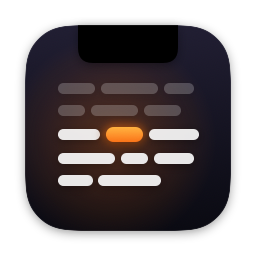

# Notchy [](https://github.com/lucianodiisouza/notchy-desktop-macos/releases)



A teleprompter that lives in your Mac's notch. Your script scrolls while you speak and stops when you pause, or it
follows your words and keeps the line you are reading in view.

**Free and open source.** No subscriptions, no accounts, no backend. Native SwiftUI + AppKit, macOS 14 or later.
English and Brazilian Portuguese, plus 26 more languages for most of the app.

[](https://www.buymeacoffee.com/oprimodev)

---

## Install

1. Download the notarized `Notchy-X.Y.Z.dmg` from [Releases](https://github.com/lucianodiisouza/notchy-desktop-macos/releases).
2. Open it and drag **Notchy** to **Applications**.
3. Open Notchy. It is signed with a Developer ID and notarized by Apple, so it opens without warnings.

Notchy asks for the microphone the first time it listens, and for speech recognition the first time you turn on
"Follow my words". Both stay on your Mac.

**Coming from 0.1?** Notchy and Notchy Scripts are now one app. Your scripts carry over. You can delete
`Notchy Scripts.app` from Applications.

The download build checks GitHub for new versions and offers them in the menu bar and in Settings → About.

---

## How to use

1. **Open Notchy.** The prompter drops down from the notch (on Macs without a notch, from a strip at the top center).
2. **Paste your script** with ⌘V, type it in, or write it in the **Scripts** window (⌘⇧R).
3. **Speak.** Pick how your voice drives the text in Settings → Voice:
   - **Voice level:** the text scrolls at the set speed while there is sound and stops when you pause.
   - **Follow my words:** Notchy recognizes what you say, on this Mac, and keeps the line you are reading about a
     third of the way down. Skip a sentence or go back and it follows. Click a word to continue from there.
4. **Collapse** the prompter with the arrow; hover the notch to bring it back.

### Keyboard shortcuts

| Shortcut | Action |
|----------|--------|
| ⌘⇧T | Show or hide the prompter |
| ⌘⇧R | Scripts window |
| ⌘⇧D | Put the prompter back in the notch |
| ⌘, | Settings |
| ⌘V | Paste a new script into an empty prompter |
| Space | Play or pause steady scrolling (while not typing in the text) |
| ↑ / ↓ | Scroll a little |
| ⇧↑ / ⇧↓ | Faster / slower |
| ⌘0 | Back to the top |
| ⌘⇧P | Send the open script to the prompter (Scripts window) |

---

## Features

- **Notch prompter** that sits in the menu bar layer, on every Space and over full-screen apps.
- **Follow my words:** on-device speech recognition lines your words up with the script. On macOS 26 it uses Apple's
  SpeechAnalyzer, which covers about 30 languages and downloads each one once; on earlier systems, the languages the
  Mac recognizes offline. Lines already read fade and the current word is marked.
- **Voice level:** the original mode, with adjustable sensitivity.
- **Scripts window:** folders, drag and drop, search, bold / italic / underline / size, export to text.
- **Settings** in the same style as PrimoDock, CameraMan and DailyNotch, with search: Text, Scrolling, Voice, Notch,
  Editor, General, Shortcuts, About.
- **Mirror** horizontally, vertically or both, for beam-splitter glass or an iPad reflection.
- **Any microphone** for Notchy alone; your Mac's default input stays as it is.
- **Stealth** by default: screen recordings and screenshots leave the prompter out (switch it off in Settings →
  Notch). Modern capture tools that record the whole display may still show it; for full invisibility, put the
  script on a second display.
- **Private:** no account, no analytics. See [PRIVACY.md](PRIVACY.md).

---

## Build from source

```bash
open Notchy.xcodeproj   # then ⌘R
```

or:

```bash
./scripts/run.sh            # build (Debug) and (re)launch
./scripts/run.sh release    # build Release and launch
./scripts/wipe.sh           # remove the app, its settings AND scripts from this Mac
```

Developer notes, signing and releasing are in [CONTRIBUTING.md](CONTRIBUTING.md).

---

## Contributing

Contributions are welcome. See [CONTRIBUTING.md](CONTRIBUTING.md) for the workflow and for opening issues.

---

## License

MIT. See [LICENSE](LICENSE).
